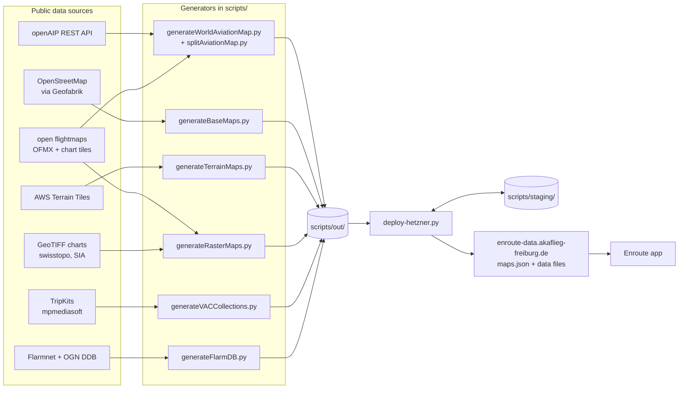

# Architecture

*Audience: anyone who wants to understand how the pipeline fits together before reading or changing the scripts.*

This repository is a set of independent scripts, not an application. Each generator downloads public data, converts it into a format that the [Enroute Flight Navigation](https://akaflieg-freiburg.github.io/enroute/) app understands, and writes the result into `scripts/out/`. A single deploy script then uploads everything that has changed to the download server and rewrites the map index `maps.json`. The app reads `maps.json` and offers the files to its users.

## Products

| Product | Generator | Output | Format spec |
|---|---|---|---|
| Aviation maps (airspaces, airfields, navaids, reporting points, procedures) | `generateWorldAviationMap.py`, then `splitAviationMap.py` | `out/{Continent}/{Region}.geojson` | [geojson](formats/geojson.md) |
| Vector base maps (roads, water, places, …) | `generateBaseMaps.py` | `out/{Continent}/{Region}.mbtiles` | [basemap](formats/basemap.md) |
| Terrain data | `generateTerrainMaps.py` | `out/{Continent}/{Region}.terrain` | [terrain](formats/terrain.md) |
| Raster charts (ICAO charts, open flightmaps VFR charts) | `generateRasterMaps.py` | `out/Europe/{Chart name}.raster` | [raster](formats/raster.md) |
| Visual approach charts | `generateVACCollections.py` | `out/{Continent}/{Name}.vac` | [vac](formats/vac.md) |
| Flarm ID database | `generateFlarmDB.py` | `out/Flarm Database.txt` | [flarm-database](formats/flarm-database.md) |
| Map index | `deploy-hetzner.py` | `staging/maps.json` | [maps-json](formats/maps-json.md) |

## Regions: `regions.py`

[`scripts/regions.py`](../scripts/regions.py) is the central registry. It defines:

- `continents`: the continent names, which become directory names on the server, with the URL of the Geofabrik OSM extract for each continent.
- `regions`: one entry per downloadable region, with `continent`, `name` (used as the file name), `bbox` (`[lon_min, lat_min, lon_max, lat_max]`) and `country`. The `country` is the `SOVEREIGNT` name of the country in the Natural Earth data set.
- `bufferedBoundary(region)`: the country shape, cut to the bounding box and grown by 25 km. Aviation maps include every feature that intersects this shape, in full. Large airspaces therefore reach well beyond it.

Base maps and terrain data do not use `bufferedBoundary`. They drop tiles that do not intersect the whole country grown by 20 km (`vector_tile.foreignTiles`); base maps also drop tiles outside the bounding box.

`splitAviationMap.py`, `generateBaseMaps.py`, `generateTerrainMaps.py` and `deploy-hetzner.py` all iterate over `regions`. Importing `regions.py` loads the Natural Earth country shapes from `scripts/data/`, so every script that imports it needs [the one-time data download](setup.md#one-time-data-download).

## Aviation data: two sources

The aviation maps combine two sources:

| Source | Reader | Provides |
|---|---|---|
| [openAIP](https://www.openaip.net) (worldwide) | [`openAIP2.py`](../scripts/openAIP2.py) | airfields, airspaces, navaids, reporting points |
| [open flightmaps](https://www.openflightmaps.org) (the regions listed at the top of `OFMX.py`) | [`OFMX.py`](../scripts/OFMX.py) | nature reserve areas, procedures (traffic circuits, arrival/departure routes), reporting points |

`generateWorldAviationMap.py` reads the open flightmaps features first and then the openAIP features. It then removes exact duplicates and any reporting point that lies less than 1 km from one already seen. Since open flightmaps comes first, **open flightmaps wins** when both sources contain the same reporting point. The result is a single `worldAviationMap.geojson`, which `splitAviationMap.py` cuts into regions.

**Data errors** (a wrong frequency, a missing reporting point) are almost always errors in openAIP or open flightmaps. The best fix is upstream, so that every user of those databases benefits.

## Directories under `scripts/`

| Directory | Content | In git? |
|---|---|---|
| `out/` | Freshly generated files, waiting for deployment. `deploy-hetzner.py` moves changed files to `staging/` and deletes unchanged ones. | no |
| `staging/` | A mirror of the server directory. It is synchronized with the server at the start and at the end of every deployment. | no |
| `data/` | Natural Earth shapes and OSM water polygons, from `downloadData.sh` | no |
| `tiff_storage/`, `ofm_storage/{airac}/`, `tripkit_storage/`, `dfs_storage/`, `terrain_storage/` | Download caches, so that unchanged sources are not downloaded again. Delete an entry to force a rebuild. | no |
| `tilemaker/` | tilemaker configuration (`config.json`) and tag processing (`process.lua`) for base maps | yes |

Never edit `out/` or `staging/` by hand. Both are production data.

## Conventions

- All scripts are run from inside `scripts/`, because they use relative paths.
- GeoJSON output is compact and deterministic: `json.dumps(..., sort_keys=True, separators=(',', ':'))`, with a top-level `info` string that contains the generation date. Deterministic output lets the deploy step recognize unchanged files.
- `generateRasterMaps.py` and `generateVACCollections.py` skip sources that have not changed (HTTP `Last-Modified`, ETags, file times), so re-running them is cheap. The other generators always rebuild everything they are asked for.
